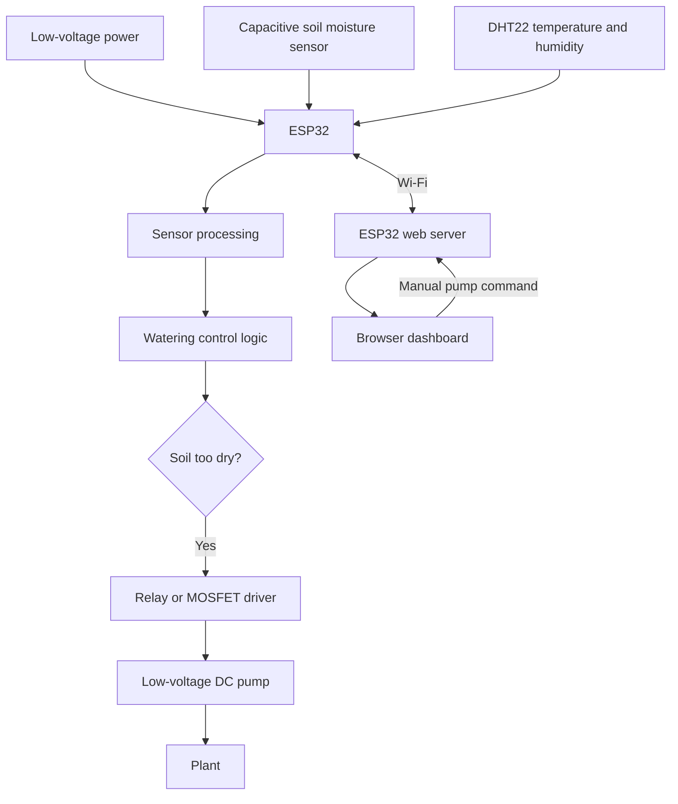

# Smart Plant Monitoring System 🌱

An ESP32-based IoT project that monitors soil moisture, temperature, and humidity. It hosts a responsive web dashboard and can automatically run a small low-voltage DC water pump when the soil becomes too dry.

## Features

- Live soil-moisture, temperature, and humidity readings
- ESP32-hosted dashboard (no cloud account required)
- Automatic watering with a maximum pump runtime
- Manual pump ON/OFF controls from the dashboard
- Watering cooldown to reduce repeated activation
- JSON status endpoint for integrations

## Architecture

See [`docs/architecture.mmd`](docs/architecture.mmd) for the Mermaid diagram.



## Parts

| Part | Suggested option | Notes |
|---|---|---|
| Controller | ESP32 DevKit | Main controller and Wi-Fi |
| Soil sensor | Capacitive soil moisture sensor | Prefer capacitive over resistive probes |
| Environment sensor | DHT22 | DHT11 can be used with a small code change |
| Pump switch | Logic-compatible MOSFET driver or relay module | Must be rated for the pump |
| Pump | Small 3–6 V DC mini pump | Use a separate suitable supply |
| Power | Regulated supply for ESP32 and pump | Common ground is required for a MOSFET driver |

## Wiring

Default pins in `firmware/smart_plant_monitor.ino`:

| ESP32 pin | Connect to |
|---|---|
| GPIO 34 | Soil sensor analog output |
| GPIO 4 | DHT22 data |
| GPIO 26 | Driver/relay input |
| 3V3 | Soil sensor VCC and DHT22 VCC (check your module's voltage requirements) |
| GND | Sensor grounds and driver logic ground |

For a bare DHT22, add a 4.7k–10k pull-up resistor between DATA and 3V3. Many DHT22 modules already include one.

**Pump power:** Do not power the pump from an ESP32 GPIO pin or the ESP32 3V3 pin. Use a separate, correctly rated low-voltage DC supply and a suitable driver. For a MOSFET driver, connect the supply ground to ESP32 ground. For a relay module, follow its input-voltage and isolation requirements. Add a flyback diode across a bare DC motor/pump if the driver board does not already provide suitable protection. Keep water away from exposed electronics. Do not use mains wiring for this project.

## Setup

1. Install Arduino IDE and the ESP32 board package.
2. Install the **DHT sensor library by Adafruit** and **Adafruit Unified Sensor** from Library Manager.
3. Open `firmware/smart_plant_monitor.ino`.
4. Replace `YOUR_WIFI_NAME` and `YOUR_WIFI_PASSWORD` with your Wi-Fi credentials.
5. Select your ESP32 board and port, then upload.
6. Open Serial Monitor at **115200 baud**.
7. Find the IP address printed by the ESP32 and open it in a browser on the same Wi-Fi network.

The ESP32 and phone/computer must be connected to the same local network.

## Calibrate the soil sensor

The percentage depends on the exact sensor and soil. In the firmware, find:

```cpp
const int SOIL_DRY_RAW = 3000;
const int SOIL_WET_RAW = 1400;
```

1. Record `soilRaw` with the probe in dry soil/air (keep electronics out of water).
2. Record `soilRaw` with the probe in thoroughly moist soil.
3. Put those readings into `SOIL_DRY_RAW` and `SOIL_WET_RAW`.
4. Adjust `MOISTURE_START_PERCENT` after observing your plant and soil.

The displayed percentage is an approximate, calibrated indicator, not a laboratory measurement.

## How automatic watering works

- The controller samples sensors periodically.
- If moisture falls below `MOISTURE_START_PERCENT`, the pump runs for at most `PUMP_MAX_RUNTIME_MS`.
- A cooldown prevents another automatic watering cycle for `WATERING_COOLDOWN_MS`.
- Manual watering is also limited to the maximum runtime.
- The pump output is switched off on boot and whenever a watering cycle ends.

Start with a short pump runtime and test the water flow into a container before placing the outlet near a plant. Never leave the prototype unattended during early testing. Sensor readings and watering thresholds need calibration for your soil and plant.

## HTTP API

| Endpoint | Description |
|---|---|
| `GET /` | Dashboard |
| `GET /api/status` | Current readings and pump state as JSON |
| `GET /api/pump?state=on` | Start a time-limited manual watering cycle |
| `GET /api/pump?state=off` | Stop the pump |

Example status response:

```json
{
  "soilRaw": 2100,
  "soilMoisture": 56,
  "temperatureC": 26.4,
  "humidity": 61.0,
  "pumpOn": false,
  "mode": "AUTO"
}
```

## Repository structure

```text
smart-plant-monitor/
├── firmware/
│   └── smart_plant_monitor.ino
├── docs/
│   └── architecture.mmd
├── .gitignore
└── README.md
```

## Future improvements

- Store historical readings in Firebase or InfluxDB
- Add MQTT support and a Grafana dashboard
- Add a water-tank level sensor
- Add multiple plant zones
- Add alerts when the sensor is disconnected or the water tank is empty

## License

MIT — see `LICENSE` if you choose to add one.
